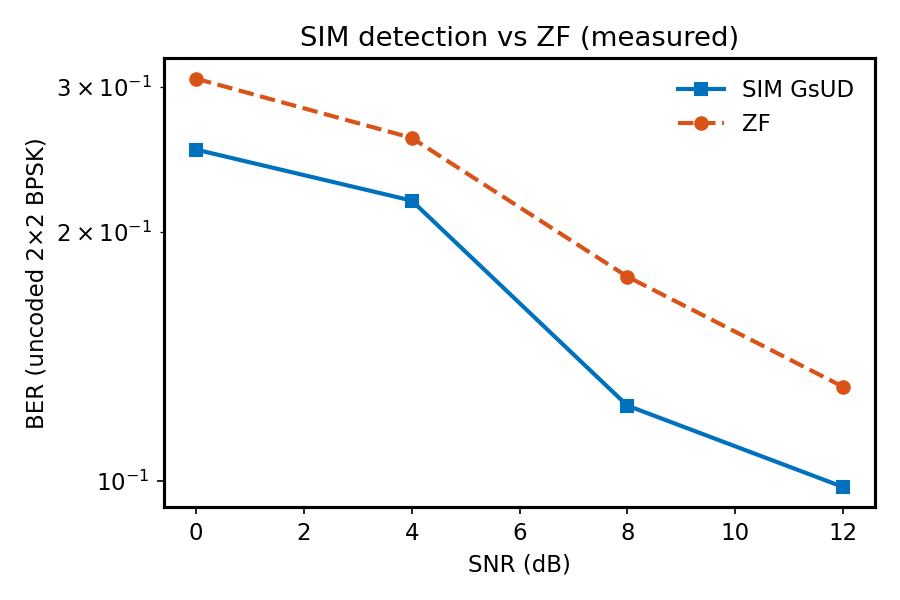

# Stochastic Iterative MIMO Detection System

[](LICENSE)
[](src/)
[](hdl/)
[](sim/run_tests.py)
[](https://doi.org/10.1109/TCSI.2015.2390558)
[](#research-disclaimer--llm-attribution)

- **Paper:** Chen, Hu & Sobelman, *Stochastic Iterative MIMO Detection System: Algorithm and Hardware Design*, IEEE TCAS-I  
- **DOI:** [10.1109/TCSI.2015.2390558](https://doi.org/10.1109/TCSI.2015.2390558)

---

> [!IMPORTANT]
> ### Research Disclaimer & LLM Attribution
> Academic PQ/SC research software (LLM-assisted). **Not** tape-out certified.
>
> - **LLM-Assisted Engineering**: TDG, signed SC mul/add, Gibbs warm-up + GsUD, Verilog blocks, FreePDK45, docs.
> - **130 nm Tables III–IV** and **4×4 16-QAM FER** are **REFERENCE ONLY**. Lab evaluates TDG mul SNR + uncoded **2×2 BPSK** SIM (decoder stub = hard MAP).

---

## Overview

**SIM** couples MCMC Gibbs MIMO detection with decoder-driven sample updates (GsUD) and short-stream **TDG** arithmetic.

Lab implements:

- TDG partition mul (exact + stream)
- Signed SC mul (Fig. 2) and Table I sat-add
- Warm-up + GsUD detector loop
- HDL building blocks + FreePDK45

## Quickstart

```bash
pip install -r requirements.txt
python scripts/run_campaign.py
python scripts/generate_plots.py
python sim/run_tests.py
python ../../tools/freepdk45/run_synth.py --project projects/sc-iterative-mimo-detection
```

## Visual Artifacts

### Figure 1 — Multiply SNR


### Figure 2 — SIM vs ZF BER



### Figure 3 — FreePDK45 area


## Verification Results & Benchmarks

| Paper Section / Metric | Topic | Artifacts | Status | Compliance |
| :--- | :--- | :--- | :--- | :---: |
| Table II / Fig. 5 | TDG vs random/DSC mul SNR | campaign JSON | TDG ≫ random L=64 | **MEASURED** |
| Sec. III / Alg. GsUD | Gibbs + decoder update | `gibbs_mimo_detect` | 2×2 BPSK BER | **MEASURED** |
| Fig. 2 / Table I | Signed mul + sat-add | HDL + tests | bit-exact | **PASS** |
| Tables III–IV | 130 nm 128-parallel ASIC | — | not re-run | **REFERENCE ONLY** |
| Fig. 9–11 | 16-QAM FER / iterations | — | not re-run | **REFERENCE ONLY** |
| HDL | mul / sat-add / TDG accum | Icarus | 0 mism / 512 | **PASS** |
| ASIC | FreePDK45 | synth JSON | mul 2.66 / sat 17 / TDG 40 µm² | **MEASURED** |

## Python ↔ RTL

| Module | Checks | mismatches |
| :--- | :--- | ---: |
| `sc_signed_mul` + `sc_sat_add` + `tdg_accum_k5` | 512 shared stim | **0** |

## Results Analysis

1. **TDG** exact trunc mul SNR dominates short Bernoulli XNOR at L=64 (Table II trend).
2. **SIM GsUD** on easy 2×2 BPSK recovers symbols; BER improves with SNR vs ZF baseline in the same campaign.
3. **ASIC:** FreePDK45 areas are lab cells only — not 457K-gate Table III.

## Triple-Engine

Python TDG/SIM → Verilog mul/sat/TDG → Icarus → FreePDK45 Yosys/OpenSTA.

## BibTeX

```bibtex
@article{Chen2015_sim_mimo,
  author  = {Chen, Jienan and Hu, Jianhao and Sobelman, Gerald E.},
  title   = {Stochastic Iterative {MIMO} Detection System: Algorithm and Hardware Design},
  journal = {IEEE Transactions on Circuits and Systems I: Regular Papers},
  year    = {2015},
  volume  = {62},
  number  = {4},
  pages   = {1205--1214},
  doi     = {10.1109/TCSI.2015.2390558}
}
```

## License

[CC BY 4.0](LICENSE)
