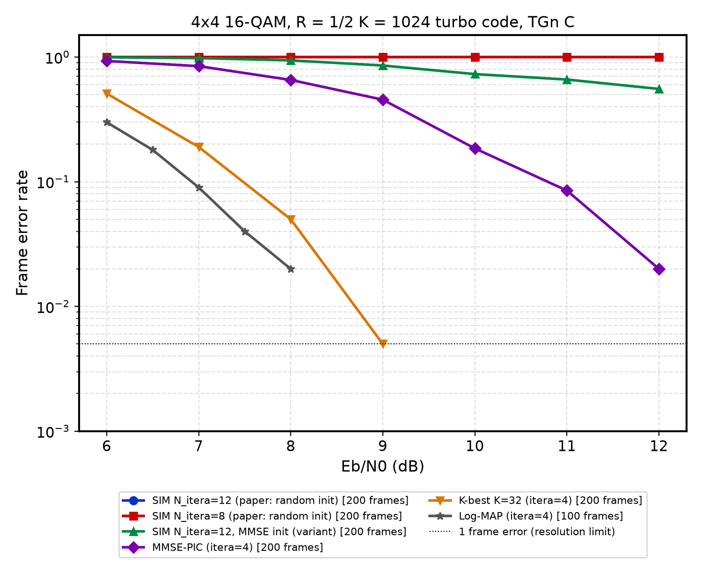
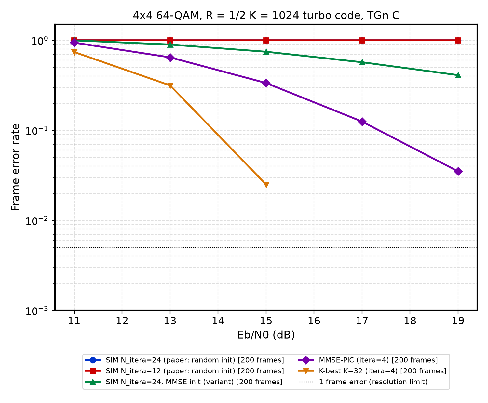
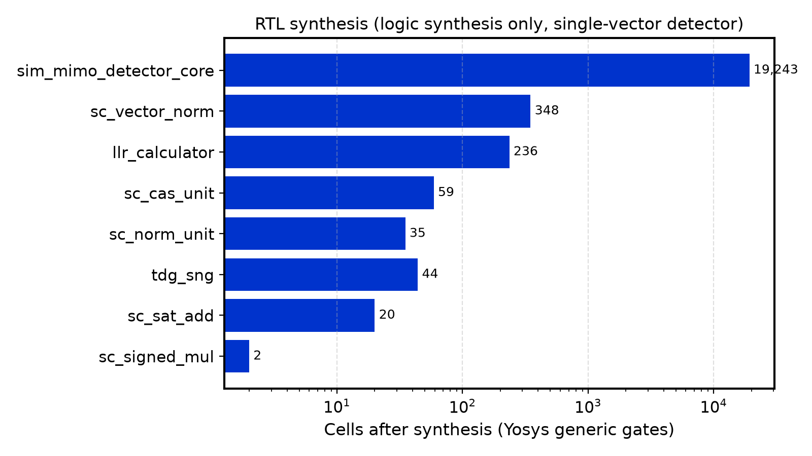

# Stochastic Iterative MIMO Detection System: Algorithm and Hardware Design

An independent re-implementation of

> J. Chen, J. Hu, and G. E. Sobelman, "Stochastic Iterative MIMO Detection System: Algorithm and Hardware Design," *IEEE Transactions on Circuits and Systems I: Regular Papers*, vol. 62, no. 4, pp. 1205–1214, Apr. 2015. [doi:10.1109/TCSI.2015.2390558](https://doi.org/10.1109/TCSI.2015.2390558)

The repository contains a floating-point model of the SIM algorithm inside a full coded MIMO link, a bit-accurate model of the stochastic detector datapath, synthesizable Verilog checked bit-exactly against that model, and the Monte Carlo campaign that regenerates every figure. Everything reported under [Results](#results) was measured with the code in this repository. Numbers taken from the paper are labelled as such.

> [!IMPORTANT]
> **The paper's headline error-rate results are not reproduced.** With the paper's parameters as written, the SIM detector never converges in this simulation; see [What does not match the paper](#what-does-not-match-the-paper). The reference detectors, turbo code, TDG and RTL all behave as expected, and the gap is documented rather than tuned away.

## Contents

- [What is implemented](#what-is-implemented)
- [Quickstart](#quickstart)
- [Paper parameters used](#paper-parameters-used)
- [Interpretation choices](#interpretation-choices)
- [Results](#results)
- [What does not match the paper](#what-does-not-match-the-paper)
- [RTL and verification](#rtl-and-verification)
- [Repository layout](#repository-layout)
- [References](#references)

## What is implemented

| Paper item | Where |
| :--- | :--- |
| System model, Eq. (1); real-valued decomposition | [`src/mimo_channel.py`](src/mimo_channel.py) |
| TGn channel model C (Sec. V-A) | `TGnChannelC` in [`src/mimo_channel.py`](src/mimo_channel.py) |
| Gray 16/64-QAM bit mapping, Eq. (11), Fig. 7 | `Constellation` in [`src/sim_mimo.py`](src/sim_mimo.py), [`src/qam.py`](src/qam.py) |
| Warm-up processing, Eqs. (7)–(9) | `SimDetector.warmup` |
| GsUD processing, Eqs. (10)–(14) | `SimDetector.gsud`, `simulate_frames` |
| Parallel LLR calculation, Eqs. (15)–(17) | `SimDetector.hypothesis_distances` |
| CAS running maximum, Eq. (18) | `SimDetector._cas`, [`hdl/sc_cas_unit.v`](hdl/sc_cas_unit.v) |
| Signed stochastic streams, Eq. (5), Fig. 1 | [`src/tdg.py`](src/tdg.py) |
| Stochastic signed multiplier, Fig. 2 | `sc_signed_mul_bits`, [`hdl/sc_signed_mul.v`](hdl/sc_signed_mul.v) |
| Stochastic signed adder, Table I, Eq. (6) | `sc_sat_add_bits`, [`hdl/sc_sat_add.v`](hdl/sc_sat_add.v) |
| Two Divisions Generator, Eqs. (19)–(22), Fig. 5 | `tdg_window`, [`hdl/tdg_sng.v`](hdl/tdg_sng.v) |
| Table II multiplier comparison | `run_table2_benchmark` in [`src/tdg.py`](src/tdg.py) |
| Turbo code, rate 1/2 K = 1024 and rate ≈ 5/6 K = 1952, BCJR | [`src/channel_code.py`](src/channel_code.py) |
| JDD schedule, Fig. 3(c), and IDD baselines | `simulate_frames` in [`src/sim_mimo.py`](src/sim_mimo.py) |
| Log-MAP [27], MMSE-PIC [8], K-best [10] reference detectors | `LogMapDetector`, `MmsePicDetector`, `KBestDetector` |
| Detector datapath, Figs. 4, 7, 8 (bit-accurate) | [`src/sc_detector.py`](src/sc_detector.py) |
| Detector datapath, Figs. 4, 7, 8 (RTL) | [`hdl/sim_mimo_detector_core.v`](hdl/sim_mimo_detector_core.v) and leaf modules |

Not implemented: the stochastic turbo decoder of [22] (a floating-point max-log BCJR stands in for it), the 128-detector array and interleaving network of Fig. 6, the trellis-search detector [6], and any physical design (place and route, timing, power).

## Quickstart

```bash
pip install -r requirements.txt
```

```bash
python sim/run_tests.py
```

`run_tests.py` runs the Python checks and both Icarus Verilog testbenches. Icarus is found on `PATH`, through `IVERILOG_BIN`, or at `C:/iverilog/bin` on Windows.

```bash
python scripts/run_campaign.py --part all --frames 200
```

```bash
python scripts/generate_plots.py
```

Synthesis uses Yosys; with no native `yosys`, the script runs the YoWASP WebAssembly build through Node (`npm install @yowasp/yosys`, then point `YOWASP_YOSYS_DIR` at its `node_modules`):

```bash
python synth/run_synth.py
```

## Paper parameters used

| Parameter | Paper (Sec. V-A) | Here |
| :--- | :--- | :--- |
| MIMO / modulation | 4×4, 16-QAM (64-QAM in Fig. 10(b)) | same |
| Channel | TGn type C | TGn model C, NLOS, λ/2 ULAs, 20 MHz OFDM data subcarriers, static per frame |
| Channel code | turbo, N_L = 1024, R = 1/2 | (13, 15)₈ RSC turbo code, S-random interleaver, alternate puncturing, max-log BCJR with 0.7 extrinsic scaling |
| Warm-up iterations | 8 | 8 |
| Outer iterations N_itera | 12 (8 also shown; 24/12 for 64-QAM) | same |
| Fixed point | 10-bit signed H, y; TDG k1 = 6, k2 = 4; L = 64; 6-bit LLR | same in the bit-accurate model and RTL |
| Random sources | 6-bit and 4-bit LFSR "Golden sequence" generators, 8 per detector | 6-bit and 4-bit de Bruijn LFSRs, 8 per detector |
| Cycles per iteration | 64 | 64 stream cycles + 1 evaluate + 1 start = 66 in the RTL |
| Parallel detectors | K = N_L / (R · M · N_t) = 128, Eq. (24) | not built (single-vector core) |
| Decoder per outer iteration | stochastic decoder, 64 cycles (SIM) / 256 cycles (traditional) | 1 turbo iteration with persistent state (SIM) / 8 turbo iterations, restarted (reference IDD) |

Eb/N0 is per information bit with E|h|² = 1 per entry and unit-energy symbols, so N0 = 1 / (log2(M) · R · Eb/N0).

## Interpretation choices

The paper leaves several details open. Each choice below is documented in the code where it is made.

1. **Prior handling in the CAS.** λ₂^e±(x_k,b) depends only on the bit itself, so it is the same for every sample inside the max of Eq. (13). The CAS (Eq. 18) therefore keeps the channel metrics −‖y − Hs‖²/σ², and λ₂ is added after it. Storing the prior inside the CAS registers mixes priors from different iterations, and in testing that made GsUD diverge. The decoder receives the extrinsic λ₁^e = λ₁ − λ₂^e, as labelled in Fig. 6.
2. **The random signal R of Eq. (8)** is drawn from a logistic distribution, which makes [l₊ − l₋ + R > 0] an exact Gibbs draw with P(x = 1) = σ(l₊ − l₋). In the RTL, R is a per-bit uniform value from the shared 6-bit generators.
3. **Parallel updates.** Every bit of the sample is updated from the same previous sample (the paper's x^(n−1) notation and its 64-cycle fully parallel hardware).
4. **Initial sample.** Section III does not say how x^(0) is chosen; Section II-A initializes randomly. Random is the default. An MMSE hard-decision start is reported separately as a variant.
5. **Decoder bits in GsUD** are the hard decisions of the decoder posterior. Sampling them from the posterior (a closer analogue of a stochastic decoder's output stream) is available as `gsud_bits="sample"`; it did not help.
6. **Norm unit of Fig. 8.** The figure shows an accumulator, a |x| ≥ U comparator and a mux feeding U back, with no equation. It is modelled as a subtract-U integrator, which outputs |d|/U as a stream, so the hardware metric is an L1 approximation of ‖d‖². U = 8 ≈ √L.
7. **TDG fine-bit timing.** The fine comparator is switched in on the cycle where the 6-bit random number is all ones. The coarse bit is always 0 there, so the Table I adder (which clears its memory on a (1, 0) input) never drops the fine bit; every 10-bit value is then carried exactly by 16 consecutive windows.
8. **64-QAM framing.** 2048 coded bits do not fill whole 24-bit vectors, so the last of 86 vectors is padded with known zeros.
9. **Fig. 11 code.** "Length 1952, rate 5/6" is implemented as K = 1952 information bits plus 400 parity bits (2352 coded bits, rate 0.83, 147 vectors).

## Results

All curves come from `benchmarks/results/sim_campaign.json`; frame counts are in the legends. With 200 frames per point, an FER below about 5·10⁻³ is not resolved, so the paper's 10⁻³ operating points are out of reach of this campaign.

### Table II: stochastic multipliers

Inputs are 10-bit sign-magnitude values drawn uniformly from [-1, 1]; SNR uses the paper's definition, 10 log10( Σ Test² / Σ (Float − Test)² ), over 2000 products.

| Method | Latency | Paper SNR (dB) | Measured SNR (dB) |
| :--- | :---: | :---: | :---: |
| Random [16] | 1024 | 43.0 | 29.4 |
| DSC [25] (ramp × bit-reversed counter) | 1024 | 57.8 | 48.1 |
| DSC [25] | 64 | 34.1 | 31.3 |
| SWG [23] (random 64-bit window of a 1024-bit stream) | 64 | 27.8 | 17.3 |
| TDG, deterministic generators | 64 | 39.1 | 29.1 |
| TDG, de Bruijn LFSRs (as in the RTL) | 64 | — | 27.3 |

The ordering of DSC above Random and of DSC/TDG above SWG matches the paper, but every measured value is lower. TDG does not beat DSC at L = 64 here. A 64-cycle AND of two streams cannot resolve a 10-bit product. TDG's fine bits make each 16-window average exact, but a single 64-cycle product does not benefit. The paper does not give its input distribution or generator pairing, which may explain part of the gap.


### Fig. 10: coded FER

FER after the last outer iteration, 200 frames per point (Log-MAP: 100).

**16-QAM** (Fig. 10(a)), Eb/N0 in dB:

| Detector | 6 | 7 | 8 | 9 | 10 | 11 | 12 |
| :--- | :---: | :---: | :---: | :---: | :---: | :---: | :---: |
| SIM N_itera = 12 (paper settings) | 1.000 | 1.000 | 1.000 | 1.000 | 1.000 | 1.000 | 1.000 |
| SIM N_itera = 8 (paper settings) | 1.000 | 1.000 | 1.000 | 1.000 | 1.000 | 1.000 | 1.000 |
| SIM N_itera = 12, MMSE start | 0.995 | 0.980 | 0.940 | 0.855 | 0.730 | 0.660 | 0.555 |
| MMSE-PIC, 4 outer | 0.930 | 0.845 | 0.655 | 0.455 | 0.185 | 0.085 | 0.020 |
| K-best K = 32, 4 outer | 0.510 | 0.190 | 0.050 | 0.005 | 0 | 0 | 0 |

Exhaustive Log-MAP with 4 outer iterations (100 frames per point): FER 0.300, 0.180, 0.090, 0.040 and 0.020 at 6, 6.5, 7, 7.5 and 8 dB.

The paper reports FER = 10⁻³ at 7 dB for SIM with N_itera = 12, within 0.25 dB of the Log-MAP detector.

**64-QAM** (Fig. 10(b)), Eb/N0 in dB:

| Detector | 11 | 13 | 15 | 17 | 19 |
| :--- | :---: | :---: | :---: | :---: | :---: |
| SIM N_itera = 24 (paper settings) | 1.000 | 1.000 | 1.000 | 1.000 | 1.000 |
| SIM N_itera = 12 (paper settings) | 1.000 | 1.000 | 1.000 | 1.000 | 1.000 |
| SIM N_itera = 24, MMSE start | 0.995 | 0.895 | 0.745 | 0.570 | 0.410 |
| MMSE-PIC, 4 outer | 0.940 | 0.645 | 0.335 | 0.125 | 0.035 |
| K-best K = 32, 4 outer | 0.740 | 0.315 | 0.025 | 0 | 0 |

The paper reports FER ≈ 10⁻³ near 11.5 dB for SIM with N_itera = 24.





### Fig. 9: iterations to convergence

Frames out of 200 that decode correctly, and after how many outer iterations (maximum 16):

| Start | Eb/N0 | Decoded | Most common iteration count |
| :--- | :---: | :---: | :--- |
| random (paper settings) | 6.8 dB | 0 | — |
| random (paper settings) | 7.0 dB | 0 | — |
| random (paper settings) | 7.2 dB | 0 | — |
| MMSE | 10 dB | 48 | spread over 2–16 |
| MMSE | 12 dB | 92 | 3–4 |
| MMSE | 14 dB | 136 | 2–3 |

The paper's Fig. 9 shows nearly all of 10K frames converging within 2–8 iterations at 6.8–7.2 dB.


### Fig. 11: BER vs outer iterations with a BCJR decoder

BER after the first and last outer iterations (200 frames):

| Configuration | 11 dB, first → last | 13 dB, first → last |
| :--- | :---: | :---: |
| MMSE, I_dec = 8, I_outer = 4 | 0.118 → 0.123 | 0.095 → 0.098 |
| SIM detector, I_dec = 4, I_outer = 8 | 0.331 → 0.306 | 0.331 → 0.307 |
| SIM detector, I_dec = 3, I_outer = 10 | 0.331 → 0.303 | 0.331 → 0.305 |
| SIM detector, I_dec = 4, I_outer = 8, MMSE start | 0.139 → 0.133 | 0.114 → 0.108 |

In the paper, MMSE reaches about 7·10⁻³ (11 dB) and 5·10⁻⁵ (13 dB), and the stochastic MCMC detector matches or beats it after 8–10 outer iterations. Here no configuration decodes the rate-0.83 code at these SNRs on TGn-C.


### Throughput

The paper gives 787.5 Mb/s at 500 MHz with 8 warm-up and 12 outer iterations of 64 cycles, but not the formula. From the stated parameters:

| Assumption | Throughput |
| :--- | :---: |
| 1024 information bits per 20 × 64 cycles | 400 Mb/s |
| 2048 coded bits per 20 × 64 cycles | 800 Mb/s |
| 2048 coded bits per 20 × 65 cycles | 787.7 Mb/s |

787.5 Mb/s is therefore consistent with counting coded bits and one extra cycle per iteration. The RTL here uses 66 cycles per iteration (64 stream cycles, 1 evaluate, 1 start).

### Synthesis

Logic synthesis with Yosys (`synth -flatten`, generic gate library; [`benchmarks/synth_results.json`](benchmarks/synth_results.json)). No technology mapping, placement, timing or power analysis was run, so these are cell counts, not areas.

| Module | Cells | Flip-flops |
| :--- | ---: | ---: |
| `sc_signed_mul` (Fig. 2) | 2 | 0 |
| `sc_sat_add` (Table I) | 20 | 0 |
| `tdg_sng` (Fig. 5(b); the adder memory is removed as dead logic because coarse and fine are never both 1) | 44 | 0 |
| `sc_norm_unit` | 35 | 4 |
| `sc_cas_unit` (8-bit) | 59 | 8 |
| `llr_calculator` (Fig. 8, one bit) | 236 | 16 |
| `sc_vector_norm` (8 norm units, SA cascade, TCS) | 348 | 46 |
| `sim_mimo_detector_core` (one vector) | 19,243 | 1,510 |

The paper reports 457.4K NAND2-equivalent gates for 128 detectors, about 3.6K per detector. This core holds 1,510 flip-flops on its own (mostly the 1-bit SA memories of the 64 H streams, the d calculator and the 16 × 8 flipped vectors, plus the norm integrators and counters), so this datapath reading cannot fit in that budget. The paper's detectors must share more logic than its figures show.



### Tables III and IV (paper values, not reproduced)

Table III reports a 128-detector post-layout design: library `cb13fs120_tsmc` (the text says SMIC 130 nm), 1.98 mm² total area (0.763 combinational, 0.468 non-combinational, 0.593 net interconnect), 500 MHz, 1.2 V, 314 mW, 16 Gbps per LLR exchange and 787.5 Mbps iterative throughput.

| | This work | [6] | [8] | [14] | [23] | [26] | [28] |
| :--- | :---: | :---: | :---: | :---: | :---: | :---: | :---: |
| Algorithm | SIM | PPTS L=2 | SISO MMSE-PIC | MCMC bitwise | Stochastic detector | Soft STS | FSD |
| Result from | post layout | post synthesis | measured | post synthesis | post synthesis | post layout | post layout |
| Constellation | 16-QAM | 16-QAM | 64-QAM | 16-QAM | 16-QAM | 64-QAM | 64-QAM |
| Iterations | 12 | 4 | 4 | 4 | N/A | 4 | 4 |
| Clock | 500 MHz | 320 MHz | 568 MHz | 620 MHz | 500 MHz | 71 MHz | 167 MHz |
| Max throughput per LLR exchange | 16 Gbps | 1.7 Gbps (850 Mbps)ᵃ | 757 Mbps (524 Mbps)ᵃ | 38.75 Mbps | 1.5 Gbps | 100 Mbps (200 Mbps)ᵃ | 1 Gbps (500 Mbps)ᵃ |
| Iterative throughputᵈ | 787.5 Mbps | 213 Mbps | 131 Mbps | 9.6 Mbps | 375 Mbps | 50 Mbps | 125 Mbps |
| Core area | 1.98 mm² | 1.58 mm² | 1.3 mm² | N/A | N/A | 1.9 mm² | 0.25 mm² |
| Gate count | 457.4K | 1097K | 359.6K | 29.6K | 614K | 56.8K | 83.7K + 30K |
| Technology | 130 nm | 65 nm | 90 nm | 130 nm | 130 nm | 250 nm | 65 nm |
| Power | 314 mW | N/A | 189.1 mW (273.1 mW) | N/A | N/A | N/A | 59.3 mW (118.6 mW) |
| Hardware efficiencyᵃ (Mb/s/kGE) | 1.71 | 0.2 | 0.36 | 0.324 | 0.61 | 0.88 | 1.09 |
| Energy efficiencyᵃ (nJ/bit) | 0.4 | N/A | 2.08 | N/A | N/A | N/A | 0.94 |

ᵃ scaled to 130 nm by the paper (throughput ∝ 1/s, power ∝ (1/s)(V_dd/V'_dd)). ᵈ assumes the LDD method of [24].


## What does not match the paper

1. **SIM does not converge with the paper's settings.** From a random start, 8 parallel warm-up iterations leave about 31–34% of coded bits wrong at every SNR tested (6–19 dB). From there the decoder's hard decisions cannot pull the sampler toward the transmitted vector: FER = 1 everywhere, and 0 of 600 frames converge at the Fig. 9 SNRs. This is the known high-SNR stalling of Gibbs samplers. An MMSE starting sample helps, but SIM stays well behind MMSE-PIC and K-best.
2. **Every detector, including Log-MAP, is worse than in the paper.** Log-MAP gives FER 0.09 at 7 dB against the paper's ≈ 10⁻³ near 6.6 dB, about 1.5–2 dB apart, and MMSE-PIC is further off. The channel setup is the most likely cause: the TGn-C antenna correlation at λ/2 spacing (0.74 between adjacent antennas) is high, and the paper does not state its antenna spacing, OFDM mapping or Doppler. So the absolute SNR axis is not comparable, but the ordering is: K-best and Log-MAP ≫ MMSE-PIC ≫ SIM (MMSE start) ≫ SIM (paper settings).
3. **Table II** values are 3–14 dB below the paper (see above).
4. **Gate count.** The single-vector core needs 1,510 flip-flops, which is more than the paper's ≈ 3.6K gates per detector allows.
5. **Things the paper leaves unspecified**, listed under [Interpretation choices](#interpretation-choices). A different reading of any of them could change the results; in particular the initial sample, the R distribution and the CAS/prior handling all had large effects in testing.

## RTL and verification

The RTL implements one detector for one 4×4 16-QAM vector (the paper instantiates 128). Each `start` runs one 64-cycle iteration:

- 64 TDG stream sources for H and 8 for y (`tdg_sng`), with five 6-bit and three 4-bit de Bruijn generators (`debruijn_gen`);
- the bit-mapping unit (outer level: all ones; inner level: `100` repeating, value 1/3);
- the d calculator, d(k) = SA(y_k, −SA-chain of SM(H_kj, s_j)) (Eq. 15), and the 16 bit-flipped vectors d − H(:, k)(s_flip − s_k) (Eq. 17);
- 17 × 8 norm units, SA cascades and TCS converters (`sc_vector_norm`);
- 16 LLR calculators with two CAS units each and stream generators (`llr_calculator`, Fig. 8);
- the Eq. (8) sample update in warm-up mode, or loading of the decoder bits in GsUD mode.

[`sim/gen_stim.py`](sim/gen_stim.py) generates stimulus from the Python models. [`hdl/tb_units.v`](hdl/tb_units.v) checks every leaf module for 2000 random cycles, and [`hdl/tb_core.v`](hdl/tb_core.v) checks the full core against [`src/sc_detector.py`](src/sc_detector.py). The core check covers the sample x, all 16 λ₁^e and all 17 TCS counts after every one of 30 warm-up and GsUD iterations over 6 channels. Both report 0 mismatches.

The bit-accurate model is much less precise than the floating-point algorithm. For a sample with 12% wrong bits at 12–20 dB on i.i.d. Rayleigh channels:
- its counts correlate with the ideal L1 metric at about 0.90;
- its LLR signs agree with the floating-point L2 LLRs about 74% of the time;
- its hard-decision BER is 0.28–0.29, against 0.17–0.19 for the floating-point model.

This reflects the 64-cycle streams, the saturating SA cascade and the L1 norm unit.

## Repository layout

```
src/            algorithm, channel, code and bit-accurate stochastic models
hdl/            Verilog RTL and the two testbenches
sim/            stimulus generation, Icarus runner, test suite
synth/          Yosys flow (targets.json, run_synth.py, yosys_wasm.mjs)
scripts/        Monte Carlo campaign and plotting
benchmarks/     campaign results (results/sim_campaign.json) and synthesis results
docs/figures/   generated figures
report.md       compliance summary against the paper
```

## References

The bracketed numbers follow the paper's reference list.

- [6] Y. Sun and J. R. Cavallaro, "Trellis-search based soft-input soft-output MIMO detector: Algorithm and VLSI architecture," *IEEE Trans. Signal Process.*, vol. 60, no. 5, pp. 2617–2627, May 2012.
- [8] C. Studer, S. Fateh, and D. Seethaler, "ASIC implementation of soft-input soft-output MIMO detection using MMSE parallel interference cancellation," *IEEE J. Solid-State Circuits*, vol. 46, no. 7, pp. 1754–1765, Jul. 2011.
- [10] Q. Li and Z. Wang, "Improved K-best sphere decoding algorithms for MIMO systems," in *Proc. IEEE ISCAS*, 2006, pp. 1159–1162.
- [14] S. A. Laraway and B. Farhang-Boroujeny, "Implementation of a Markov chain Monte Carlo based multiuser/MIMO detector," *IEEE Trans. Circuits Syst. I, Reg. Papers*, vol. 56, no. 1, pp. 246–255, Jan. 2009.
- [16] S. L. Toral, J. M. Quero, and L. G. Franquelo, "Stochastic pulse coded arithmetic," in *Proc. IEEE ISCAS*, 2000, vol. 1, pp. 599–602.
- [22] J. Chen and J. Hu, "High throughput stochastic log-MAP turbo-decoder based on low bits computation," *IEEE Signal Process. Lett.*, vol. 20, no. 11, pp. 1098–1101, Nov. 2013.
- [23] J. Chen, J. Hu, and G. E. Sobelman, "Stochastic Markov chain Monte Carlo MIMO detector," *IEEE Trans. Signal Process.*, vol. 62, no. 6, pp. 1454–1463, 2014.
- [24] N. Preyss, A. Burg, and C. Studer, "Layered detection and decoding in MIMO wireless systems," in *Proc. DASIP*, Oct. 2012, pp. 1–8.
- [25] A. Alaghi and J. P. Hayes, "Survey of stochastic computing," *ACM Trans. Embedded Comput. Syst.*, vol. 12, no. 2s, Art. 92, 2013.
- [26] C. Studer, A. Burg, and H. Bölcskei, "Soft-output sphere decoding: Algorithms and VLSI implementation," *IEEE J. Sel. Areas Commun.*, vol. 26, no. 2, pp. 290–300, Feb. 2008.
- [27] B. M. Hochwald and S. ten Brink, "Achieving near-capacity on a multiple-antenna channel," *IEEE Trans. Commun.*, vol. 51, no. 3, pp. 389–399, Mar. 2003.
- [28] L. Liu, J. Löfgren, P. Nilsson, and V. Öwall, "VLSI implementation of a soft-output signal detector for multimode adaptive multiple-input multiple-output systems," *IEEE Trans. VLSI Syst.*, vol. 21, no. 12, pp. 2262–2273, Dec. 2013.
- TGn channel models: V. Erceg et al., "TGn Channel Models," IEEE 802.11-03/940r4, 2004.

```bibtex
@article{chen2015stochastic,
  author  = {Chen, Jienan and Hu, Jianhao and Sobelman, Gerald E.},
  journal = {IEEE Transactions on Circuits and Systems I: Regular Papers},
  title   = {Stochastic Iterative MIMO Detection System: Algorithm and Hardware Design},
  year    = {2015},
  volume  = {62},
  number  = {4},
  pages   = {1205--1214},
  doi     = {10.1109/TCSI.2015.2390558}
}
```

## License

[CC BY 4.0](LICENSE).
